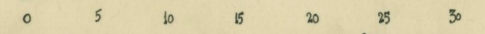

<section class="standard post-10495 chapter type-chapter status-publish hentry contributor-hamm contributor-brady" data-type="chapter" dir="rtl" lang="he">
תרגום לעברית בסיוע בינה מלאכותית מתוך Open Music Theory, גרסה 2. המלל ברישיון CC BY-SA 4.0; הקרדיטים הפרטניים לנכסים נשמרים. לפרק זה טרם הופקה קריינות.<a href="https://viva.pressbooks.pub/openmusictheory/chapter/twentieth-century-rhythmic-techniques/"> פרק המקור</a><a href="https://creativecommons.org/licenses/by-sa/4.0/"> הרישיון</a>

Samuel Brady and Chelsey Hamm

עיקרי הדברים

<ul>
<li dir="rtl" lang="he">משקלים א־סימטריים כוללים תיבות המחולקות לקבוצות לא שוות של פעמות או חלוקות פעמה, ויוצרים פעימות משקליות לא שוות.</li>
<li dir="rtl" lang="he">מוזיקה ללא משקל נתפס, אמטרית, עשויה לכלול סימן משקל או להיכתב בלעדיו.</li>
<li dir="rtl" lang="he">לפעמים המשקל הכתוב בתווים אינו המשקל הנתפס אצל המאזין.</li>
<li dir="rtl" lang="he">שינוי משקל הוא טכניקת הלחנה הכוללת כל שינוי של המשקל.</li>
<li dir="rtl" lang="he">פולימטר נוצר כששני משקלים או יותר מבוצעים בו־זמנית.</li>
<li dir="rtl" lang="he">מודולציה מטרית מחליקה שינויי טמפו חדים באמצעות חלוקות או קבוצות פעמות בטמפו הראשון, שמשכן מתאים למשכים בטמפו החדש.</li>
<li dir="rtl" lang="he">תיווי ציר זמן משתמש בשניות למדידת הזמן במקום בקווי תיבה ובמשקלים מסורתיים.</li>
<li dir="rtl" lang="he">קורות מניפה, <bdi dir="ltr">feathered beaming</bdi>, מציינות שינוי הדרגתי במהירות התווים תחת קורה אחת.</li>
<li dir="rtl" lang="he">אוסטינטו הוא רעיון קצבי או רעיון בעל גובה צליל החוזר על עצמו.</li>
</ul>

רשימת ההאזנה של הפרק<small class="source-references"> הפניות: <a dir="ltr" href="https://open.spotify.com/playlist/5p8RbikOo2DrEhWeD4QFCV?si=1187d9b5e7ba499c">[1]</a> </small>

מלחינים רבים במאה העשרים הרחיבו את המגוון הקצבי המסורתי של המוזיקה האמנותית המערבית. נדון בתשע טכניקות פחות מסורתיות. הן אינן בהכרח חדשות: רבות היו במוזיקה לא מערבית ואף במערבית לפני <bdi dir="ltr">1900</bdi>, אך מלחינים מערביים השתמשו בהן יותר לאחר מכן.

<h2 class="section-header" dir="rtl" id="chapter-10495-section-1" lang="he">משקל א־סימטרי</h2>

במשקל א־סימטרי התיבה מחולקת לקבוצות לא שוות של פעמות או חלוקות פעמה. המונח אינו מוסכם בכל מקום; יש המכנים זאת משקל מעורב, מורכב או לא איזוכרוני, לצד שמות נוספים. האזינו לדוגמה <bdi dir="ltr">1</bdi> ב־<bdi dir="ltr">5/8</bdi>: פעמה אחת כוללת שלוש שמיניות והשנייה שתיים, כך שנוצרת פעימה ארוכה ואחריה קצרה.

<em><iframe frameborder="0" height="1115" loading="lazy" src="https://musescore.com/user/32728834/scores/7243425/s/GS6p1r/embed" title="דוגמת האזנה או צפייה מן המקור" width="100%"></iframe>
אם הנגן או הדוגמה אינם זמינים, אפשר להשתמש בקישור למקור. זמינות המדיה תלויה בשירות החיצוני ולא אושרה בבדיקת ניגון.<a href="https://musescore.com/user/32728834/scores/7243425/s/GS6p1r/embed"> פתיחת המדיה</a>
</em>

דוגמה <bdi dir="ltr">1</bdi>. משקל א־סימטרי ב־״<bdi dir="ltr">Ladies in Their Sensitivities</bdi>״ של <bdi dir="ltr">Stephen Sondheim</bdi> משנת <bdi dir="ltr">1979</bdi>.<small class="source-references"> הפניות: <a dir="ltr" href="https://open.spotify.com/track/2tFynDMRSxj1ephdwFgX5E">[1]</a> </small>

השיר מן המחזמר <bdi dir="ltr">Sweeney Todd</bdi> משנת <bdi dir="ltr">1979</bdi>, שהלחין <bdi dir="ltr">Stephen Sondheim</bdi>. תחושת חוסר האיזון של <bdi dir="ltr">5/8</bdi> מחזקת את מחשבותיו החרדות של משרת הממליץ לאדונו להתגלח, אך מהסס בשל ההבדל במעמדם.

האזינו לדוגמה <bdi dir="ltr">2</bdi>, גם היא ב־<bdi dir="ltr">5/8</bdi>. הפעם הסדר הפוך: הפעמה הראשונה מתחלקת לשתי שמיניות והשנייה לשלוש.

<iframe frameborder="0" height="1115" loading="lazy" src="https://musescore.com/user/32728834/scores/7397384/embed" title="דוגמת האזנה או צפייה מן המקור" width="100%"></iframe>
אם הנגן או הדוגמה אינם זמינים, אפשר להשתמש בקישור למקור. זמינות המדיה תלויה בשירות החיצוני ולא אושרה בבדיקת ניגון.<a href="https://musescore.com/user/32728834/scores/7397384/embed"> פתיחת המדיה</a>

דוגמה <bdi dir="ltr">2</bdi>. משקל א־סימטרי ב־״<bdi dir="ltr">Aufbruch</bdi>״ של <bdi dir="ltr">Rolf Rudin</bdi> משנת <bdi dir="ltr">2008</bdi>, תיבות <bdi dir="ltr">141–149</bdi>.<small class="source-references"> הפניות: <a dir="ltr" href="https://www.youtube.com/watch?v=guJqsbFDpDs&amp;ab_channel=Bl%C3%A4serphilharmonieRhein-Maine.V.">[1]</a> </small>

תיבות <bdi dir="ltr">5/8</bdi> ניצבות לצד תיבות <bdi dir="ltr">3/4</bdi> טיפוסיות יותר, ויוצרות מרקם קריאה ומענה בין כלי העץ לכלי המתכת. כלי העץ נשמעים חיים ומשחקיים יותר, וכלי המתכת נחושים ועוצמתיים.

יש משקלים א־סימטריים נוספים שיחידת החלוקה בהם שמינית, כגון <bdi dir="ltr">7/8</bdi>, ‏<bdi dir="ltr">11/8</bdi> ו־<bdi dir="ltr">13/8</bdi>. אפשר לזהות את הקבוצות בקורות התווים או בהוראה מפורשת, למשל (<bdi dir="ltr">2</bdi><bdi dir="ltr">+2</bdi><bdi dir="ltr">+3</bdi>)/<bdi dir="ltr">8</bdi> או (<bdi dir="ltr">3</bdi><bdi dir="ltr">+2</bdi><bdi dir="ltr">+2</bdi>)/<bdi dir="ltr">8</bdi> במקום <bdi dir="ltr">7/8</bdi>.

האזינו לדוגמה <bdi dir="ltr">3</bdi> ב־<bdi dir="ltr">13/8</bdi>, בחלוקה <bdi dir="ltr">3</bdi><bdi dir="ltr">+3</bdi><bdi dir="ltr">+3</bdi><bdi dir="ltr">+2</bdi><bdi dir="ltr">+2</bdi>, החל ב־<bdi dir="ltr">0:17</bdi>. נסו לספור עם המוזיקה.

<iframe allowfullscreen="allowfullscreen" frameborder="0" height="152" id="oembed-4" loading="lazy" src="https://open.spotify.com/embed/track/1S5ZrjYFWNbhciAxMrLdjU?si=fa408139359a4512&amp;utm_source=oembed" style="border-radius: 12px" title="דוגמת האזנה או צפייה מן המקור" width="100%"></iframe>
אם הנגן או הדוגמה אינם זמינים, אפשר להשתמש בקישור למקור. זמינות המדיה תלויה בשירות החיצוני ולא אושרה בבדיקת ניגון.<a href="https://open.spotify.com/embed/track/1S5ZrjYFWNbhciAxMrLdjU?si=fa408139359a4512&amp;utm_source=oembed"> פתיחת המדיה</a>

דוגמה <bdi dir="ltr">3</bdi>. משקל א־סימטרי ב־״<bdi dir="ltr">Skimbleshanks</bdi>: <bdi dir="ltr">The Railway Cat</bdi>״ של <bdi dir="ltr">Andrew Lloyd Webber</bdi>.<small class="source-references"> הפניות: <a dir="ltr" href="https://open.spotify.com/track/1yjHUdUz575aFPAaGAO60L">[1]</a> </small>

השיר מן המחזמר <bdi dir="ltr">Cats</bdi> משנת <bdi dir="ltr">1981</bdi>, שהלחין <bdi dir="ltr">Andrew Lloyd Webber</bdi>. הקטע ב־<bdi dir="ltr">13/8</bdi> היה יכול להיכתב ב־<bdi dir="ltr">12/8</bdi> טיפוסי, אך השמינית הנוספת מחזקת את חיוניות הדמות ומונעת מהמאזין להתייצב בתבנית סדירה.

למשקל א־סימטרי יכולות להיות יחידות אחרות, כגון שש־עשרית או רבע. דוגמאות הן <bdi dir="ltr">5/4</bdi>, ‏<bdi dir="ltr">7/16</bdi> ו־<bdi dir="ltr">5/2</bdi>. הקבוצות עדיין לא שוות, גם כשהיחידה משתנה. דוגמה <bdi dir="ltr">4</bdi> נכתבת תחילה ב־<bdi dir="ltr">7/4</bdi> ואז מחדש ב־<bdi dir="ltr">7/8</bdi>.

<iframe frameborder="0" height="1115" loading="lazy" src="https://musescore.com/user/32728834/scores/7244349/embed" title="דוגמת האזנה או צפייה מן המקור" width="100%"></iframe>
אם הנגן או הדוגמה אינם זמינים, אפשר להשתמש בקישור למקור. זמינות המדיה תלויה בשירות החיצוני ולא אושרה בבדיקת ניגון.<a href="https://musescore.com/user/32728834/scores/7244349/embed"> פתיחת המדיה</a>

דוגמה <bdi dir="ltr">4</bdi>. משקל א־סימטרי ב־״<bdi dir="ltr">Unsquare Dance</bdi>״ של רביעיית <bdi dir="ltr">Dave Brubeck</bdi> משנת <bdi dir="ltr">1961</bdi>.<small class="source-references"> הפניות: <a dir="ltr" href="https://open.spotify.com/track/2VUo8O3ymKRYNgj97ZG2kM">[1]</a> </small>

זהו קטע מתוך <bdi dir="ltr">Unsquare Dance</bdi> של רביעיית דייב ברובק, משנת <bdi dir="ltr">1961</bdi>. ריקוד <bdi dir="ltr">square dance</bdi> טיפוסי הוא במשקל מרובע, אך ״הריקוד הלא מרובע״ הזה במשקל א־סימטרי ומערער את הציפיות. אפשר לכתוב את המקצב הן ב־<bdi dir="ltr">7/4</bdi> הן ב־<bdi dir="ltr">7/8</bdi> ועדיין לשמוע אותו הדבר.

<h2 class="section-header" dir="rtl" id="chapter-10495-section-2" lang="he">מוזיקה אמטרית</h2>

למוזיקה אמטרית אין משקל שניתן לתפוס. היא עשויה לכלול סימן משקל או להיכתב בלעדיו, ואינה בהכרח מבוצעת בסגנון מטרי קפדני. לתווים עדיין יכולים להיות ערכים קצביים, אך המשכים אינם יוצרים בהכרח תבנית פעמות נתפסת. הטכניקה מאפשרת אלתור ופיסוק אישי ונמצאת בקדנצות סולניות, באלתור חופשי, בשירה גרגוריאנית ובמוזיקה פוסט־טונלית. האזינו לשיר הפוסט־טונלי בדוגמה <bdi dir="ltr">5</bdi>, ללא סימן משקל.

<iframe frameborder="0" height="1115" loading="lazy" src="https://musescore.com/user/32728834/scores/25132750/embed" title="דוגמת האזנה או צפייה מן המקור" width="100%"></iframe>
אם הנגן או הדוגמה אינם זמינים, אפשר להשתמש בקישור למקור. זמינות המדיה תלויה בשירות החיצוני ולא אושרה בבדיקת ניגון.<a href="https://musescore.com/user/32728834/scores/25132750/embed"> פתיחת המדיה</a>

דוגמה <bdi dir="ltr">5</bdi>. היעדר משקל ב־״<bdi dir="ltr">The Cage</bdi>״ של <bdi dir="ltr">Charles Ives</bdi>, בערך <bdi dir="ltr">1904</bdi>.<small class="source-references"> הפניות: <a dir="ltr" href="https://open.spotify.com/episode/2w2x1k42sEvuoRnVKtaMGt">[1]</a> </small>

<bdi dir="ltr">The Cage</bdi>, מסביבות <bdi dir="ltr">1904</bdi>, הוא שיר של המלחין האמריקאי <bdi dir="ltr">Charles Ives</bdi>. אופיו האמטרי תומך בתיאור נמר הצועד במתח בכלובו. ללא פולס מטרי קפדני וסימן משקל מפורש, מקצב הפסנתר בלתי סדיר וממחיש את מזג החיה לאחר כליאה ממושכת.

<h2 class="section-header perceived-vs-notated" dir="rtl" id="chapter-10495-section-3" lang="he">משקל נתפס לעומת משקל כתוב</h2>

המשקל הכתוב עשוי להיות שונה מזה הנתפס, ומאזינים שונים עשויים לשמוע משקלים שונים באותו קטע. לפעמים נוצר רושם של מוזיקה ללא משקל או פעמה נתפסים, כמו בדוגמה <bdi dir="ltr">6</bdi>.

<iframe frameborder="0" height="445" loading="lazy" src="https://musescore.com/user/32728834/scores/7930598/embed" title="דוגמת האזנה או צפייה מן המקור" width="100%"></iframe>
אם הנגן או הדוגמה אינם זמינים, אפשר להשתמש בקישור למקור. זמינות המדיה תלויה בשירות החיצוני ולא אושרה בבדיקת ניגון.<a href="https://musescore.com/user/32728834/scores/7930598/embed"> פתיחת המדיה</a>

דוגמה <bdi dir="ltr">6</bdi>. משקל נתפס לעומת כתוב בתיבות <bdi dir="ltr">1–8</bdi> של ״<bdi dir="ltr">Density</bdi> <bdi dir="ltr">21.5</bdi>״ של <bdi dir="ltr">Edgard Var</bdi>è<bdi dir="ltr">se</bdi> משנת <bdi dir="ltr">1936</bdi>.<small class="source-references"> הפניות: <a dir="ltr" href="https://open.spotify.com/track/46OC9eSTSaMoJRcizstJzu">[1]</a> </small>

אף ש־<bdi dir="ltr">Density</bdi> <bdi dir="ltr">21.5</bdi>, משנת <bdi dir="ltr">1936</bdi>, כתובה במשקל <bdi dir="ltr">4/4</bdi>, המאזין תופס היעדר משקל בגלל סינקופות, חלוקות מיוחדות וקווי תיבה מטושטשים.

במקרים אחרים נתפס משקל שונה מן הכתוב, כמו בדוגמה <bdi dir="ltr">7</bdi>.

<iframe frameborder="0" height="394" loading="lazy" src="https://musescore.com/user/32728834/scores/8318699/embed" title="דוגמת האזנה או צפייה מן המקור" width="100%"></iframe>
אם הנגן או הדוגמה אינם זמינים, אפשר להשתמש בקישור למקור. זמינות המדיה תלויה בשירות החיצוני ולא אושרה בבדיקת ניגון.<a href="https://musescore.com/user/32728834/scores/8318699/embed"> פתיחת המדיה</a>

דוגמה <bdi dir="ltr">7</bdi>. המשקל הכתוב שונה מזה הנשמע.

הקטע מרמז על <bdi dir="ltr">3/4</bdi>, כפי שמציינים קווי התיבה המקווקווים, אך כתוב ב־<bdi dir="ltr">4/4</bdi>. גם ההדגשות והפתרונות ההרמוניים מחזקים את רושם <bdi dir="ltr">3/4</bdi>.

<h2 class="section-header" dir="rtl" id="chapter-10495-section-4" lang="he">שינוי משקל</h2>

טכניקה זו כוללת כל שינוי משקל. אין לה מגבלות או כללים מחייבים, והיא יכולה להתרחש פעמים רבות, אף מתיבה לתיבה. בדוגמה <bdi dir="ltr">8</bdi> הרצף הוא <bdi dir="ltr">5/8</bdi> → <bdi dir="ltr">6/8</bdi> → <bdi dir="ltr">5/8</bdi> → <bdi dir="ltr">6/8</bdi> → <bdi dir="ltr">3/8</bdi>.

<iframe frameborder="0" height="915" loading="lazy" src="https://musescore.com/user/32728834/scores/8009242/embed" title="דוגמת האזנה או צפייה מן המקור" width="100%"></iframe>
אם הנגן או הדוגמה אינם זמינים, אפשר להשתמש בקישור למקור. זמינות המדיה תלויה בשירות החיצוני ולא אושרה בבדיקת ניגון.<a href="https://musescore.com/user/32728834/scores/8009242/embed"> פתיחת המדיה</a>

דוגמה <bdi dir="ltr">8</bdi>. שינויי משקל בתיבות <bdi dir="ltr">54–60</bdi> של ״<bdi dir="ltr">Libera Me</bdi>״ מתוך הרקוויאם של <bdi dir="ltr">Tui St</bdi>. <bdi dir="ltr">George Tucker</bdi> משנת <bdi dir="ltr">1995</bdi>.

זהו צמצום של תיבות <bdi dir="ltr">54–60</bdi> מתוך <bdi dir="ltr">Libera Me</bdi> ברקוויאם של <bdi dir="ltr">Tui St</bdi>. <bdi dir="ltr">George Tucker</bdi>, משנת <bdi dir="ltr">1995</bdi>. הטקסט מתאר בפחד את יום הדין: בקשה להצלה ממוות נצחי ביום הנורא קודמת למילים שבקטע זה, ״כשהשמים מזדעזעים״. <bdi dir="ltr">Tucker</bdi> ממחישה את הכאוס בין היתר באמצעות שינויי משקל, המבטאים את זעזוע השמים בחוסר יציבות מטרית.

גם חלוקת הפעמה עשויה להשתנות מפשוטה למורכבת או להפך, כמו בדוגמה <bdi dir="ltr">9</bdi>.

<iframe frameborder="0" height="770" loading="lazy" src="https://musescore.com/user/32728834/scores/7268387/s/ORHlO6/embed" title="דוגמת האזנה או צפייה מן המקור" width="100%"></iframe>
אם הנגן או הדוגמה אינם זמינים, אפשר להשתמש בקישור למקור. זמינות המדיה תלויה בשירות החיצוני ולא אושרה בבדיקת ניגון.<a href="https://musescore.com/user/32728834/scores/7268387/s/ORHlO6/embed"> פתיחת המדיה</a>

דוגמה <bdi dir="ltr">9</bdi>. שינויי משקל בתיבות <bdi dir="ltr">10–19</bdi> של ״<bdi dir="ltr">Aegean Festival Overture</bdi>״ של <bdi dir="ltr">Andreas Markis</bdi> משנת <bdi dir="ltr">1967</bdi>, כפי ששמו כתוב במקור.<small class="source-references"> הפניות: <a dir="ltr" href="https://www.youtube.com/watch?v=x9wytT7Dr2s&amp;ab_channel=UniversityofNorthTexasCollegeConcerts">[1]</a> </small>

זהו צמצום של תיבות <bdi dir="ltr">10–19</bdi> ב־<bdi dir="ltr">Aegean Festival Overture</bdi>, משנת <bdi dir="ltr">1967</bdi>, מאת <bdi dir="ltr">Andreas Markis</bdi> לפי כתיב השם במקור. שינויי משקל נפוצים במוזיקה עממית יוונית, והמלחין משתמש בטכניקה כדי לעורר את הסגנון העממי.

לא בכל שינוי משקל נשמרת חלוקה קבועה. אפשר לשמור את הפעמה ולשנות את חלוקתה; בהמשך נדון בכך במודולציה מטרית.<small class="source-references"> הפניות: <a dir="ltr" href="#metric-modulation">[1]</a> </small>

<h2 class="section-header" dir="rtl" id="chapter-10495-section-5" lang="he">פולימטר</h2>

פולימטר הוא ביצוע בו־זמני של שני משקלים או יותר. הוא נפוץ ביצירות מודרניסטיות, שנוצרו בערך לאחר <bdi dir="ltr">1900</bdi>. המשקלים יכולים להיות מפורשים, כששני סימני משקל או יותר כתובים, או מרומזים בלבד. דוגמה <bdi dir="ltr">10</bdi> מציגה תיווי מפורש.

<iframe allowfullscreen="allowfullscreen" frameborder="0" height="281" id="oembed-1" loading="lazy" src="https://www.youtube.com/embed/mUBhtyKIZ-k?feature=oembed&amp;rel=0" title="דוגמת האזנה או צפייה מן המקור" width="500"></iframe>
אם הנגן או הדוגמה אינם זמינים, אפשר להשתמש בקישור למקור. זמינות המדיה תלויה בשירות החיצוני ולא אושרה בבדיקת ניגון.<a href="https://www.youtube.com/embed/mUBhtyKIZ-k?feature=oembed&amp;rel=0"> פתיחת המדיה</a>

דוגמה <bdi dir="ltr">10</bdi>. פולימטר ב־״<bdi dir="ltr">Arat</bdi>á<bdi dir="ltr">skor</bdi>״, שיר הקציר, של <bdi dir="ltr">B</bdi>é<bdi dir="ltr">la Bart</bdi>ó<bdi dir="ltr">k</bdi> משנת <bdi dir="ltr">1931</bdi>.<small class="source-references"> הפניות: <a dir="ltr" href="https://open.spotify.com/track/7dkjCekD1AbeodTAwboGMm">[1]</a> </small>

דוגמה <bdi dir="ltr">10</bdi> מציגה את <bdi dir="ltr">Ara t</bdi>á<bdi dir="ltr">skor</bdi>, ״שיר קציר״, משנת <bdi dir="ltr">1931</bdi>, שכתב <bdi dir="ltr">B</bdi>é<bdi dir="ltr">la Bart</bdi>ó<bdi dir="ltr">k</bdi> לשני כינורות. החל בתיבה <bdi dir="ltr">11</bdi> הוא משתמש ביותר ממשקל אחד בו־זמנית. <bdi dir="ltr">Bart</bdi>ó<bdi dir="ltr">k</bdi> הושפע מאוד ממוזיקה עממית והשתמש בפולימטר כדי לחקות את סגנונה.

דוגמה <bdi dir="ltr">11</bdi> מציגה פולימטר מרומז.

<iframe frameborder="0" height="920" loading="lazy" src="https://musescore.com/user/32728834/scores/8208440/embed" title="דוגמת האזנה או צפייה מן המקור" width="100%"></iframe>
אם הנגן או הדוגמה אינם זמינים, אפשר להשתמש בקישור למקור. זמינות המדיה תלויה בשירות החיצוני ולא אושרה בבדיקת ניגון.<a href="https://musescore.com/user/32728834/scores/8208440/embed"> פתיחת המדיה</a>

דוגמה <bdi dir="ltr">11</bdi>. פולימטר בפרק השני של רביעיית המיתרים ב־<bdi dir="ltr">F</bdi> מז׳ור של <bdi dir="ltr">Maurice Ravel</bdi> ‏(<bdi dir="ltr">1902</bdi> לפי המקור).<small class="source-references"> הפניות: <a dir="ltr" href="https://open.spotify.com/track/3uM3DuDXzmflZJosfBLRMd">[1]</a> </small>

בפרק השני של רביעיית המיתרים ב־<bdi dir="ltr">F</bdi> מז׳ור של <bdi dir="ltr">Ravel</bdi>, שהמקור מתארך ל־<bdi dir="ltr">1902</bdi>, המשקל הכתוב הוא <bdi dir="ltr">6/8</bdi> אך משתמעת גם מלודיה ב־<bdi dir="ltr">3/4</bdi>. בשבע התיבות הראשונות הכינור הראשון והצ׳לו מרמזים על <bdi dir="ltr">3/4</bdi>; הכינור השני והוויולה מתחלפים בכל תיבה בין <bdi dir="ltr">6/8</bdi> ל־<bdi dir="ltr">3/4</bdi> מרומז. החל בתיבה <bdi dir="ltr">8</bdi> שני הכלים הנמוכים מנגנים במשקל הכתוב, ושני הגבוהים מרמזים על <bdi dir="ltr">3/4</bdi>.

אפשר לפרש פולימטר מרומז גם כדיסוננס קיבוץ. לדיון מעמיק עיינו בפרק ״דיסוננס מטרי״.<small class="source-references"> הפניות: <a dir="ltr" href="omt-v2-126-metrical-dissonance.md" title="פרק במהדורה העברית">[1]</a> </small>

<h2 class="section-header" dir="rtl" id="chapter-10495-section-6" lang="he">מודולציה מטרית</h2>

מודולציה מטרית מחליקה שינויי טמפו חדים באמצעות חלוקות או קבוצות פעמות בטמפו הראשון, שמשכן מתאים למשכים בטמפו החדש. <bdi dir="ltr">[1]</bdi> כך השינוי כמעט אינו מורגש ומזוהה רק בדיעבד. בדרך כלל מסמנים מעל התווים שוויון בין ערכי תווים. בדוגמה <bdi dir="ltr">12</bdi> הוא מתרחש בתיבה <bdi dir="ltr">4</bdi>.<small class="source-references"> הפניות: <a dir="ltr" href="#footnote-10495-1">[1]</a> </small>

<iframe frameborder="0" height="394" loading="lazy" src="https://musescore.com/user/32728834/scores/7370069/embed" title="דוגמת האזנה או צפייה מן המקור" width="100%"></iframe>
אם הנגן או הדוגמה אינם זמינים, אפשר להשתמש בקישור למקור. זמינות המדיה תלויה בשירות החיצוני ולא אושרה בבדיקת ניגון.<a href="https://musescore.com/user/32728834/scores/7370069/embed"> פתיחת המדיה</a>

דוגמה <bdi dir="ltr">12</bdi>. מודולציה מטרית שבה חלוקת הפעמה נשמרת.

השמינית נשארת זהה במעבר בין <bdi dir="ltr">3/4</bdi> ל־<bdi dir="ltr">9/8</bdi>. שמירת החלוקה היא דרך אחת למודולציה מטרית.

בחנו כעת את דוגמה <bdi dir="ltr">13</bdi>.

<iframe frameborder="0" height="394" loading="lazy" src="https://musescore.com/user/32728834/scores/7370258/embed" title="דוגמת האזנה או צפייה מן המקור" width="100%"></iframe>
אם הנגן או הדוגמה אינם זמינים, אפשר להשתמש בקישור למקור. זמינות המדיה תלויה בשירות החיצוני ולא אושרה בבדיקת ניגון.<a href="https://musescore.com/user/32728834/scores/7370258/embed"> פתיחת המדיה</a>

דוגמה <bdi dir="ltr">13</bdi>. מודולציה מטרית שבה הפעמה נשמרת.

פעמת הרבע במשקל הראשון הופכת לרבע מנוקד במשקל החדש. לכן חלוקת השמיניות נעשית מהירה יותר.

בדוגמה <bdi dir="ltr">14</bdi> מופיעות מודולציות מטריות בהקשר ״<bdi dir="ltr">Canaries</bdi>״ של <bdi dir="ltr">Elliott Carter</bdi>.

<iframe frameborder="0" height="825" loading="lazy" src="https://musescore.com/user/32728834/scores/7370744/embed" title="דוגמת האזנה או צפייה מן המקור" width="100%"></iframe>
אם הנגן או הדוגמה אינם זמינים, אפשר להשתמש בקישור למקור. זמינות המדיה תלויה בשירות החיצוני ולא אושרה בבדיקת ניגון.<a href="https://musescore.com/user/32728834/scores/7370744/embed"> פתיחת המדיה</a>

דוגמה <bdi dir="ltr">14</bdi>. מודולציה מטרית בתיבות <bdi dir="ltr">1–24</bdi> של ״<bdi dir="ltr">Canaries</bdi>״ מתוך ״<bdi dir="ltr">8</bdi> <bdi dir="ltr">Pieces for</bdi> <bdi dir="ltr">4</bdi> <bdi dir="ltr">Timpani</bdi>״ של <bdi dir="ltr">Elliott Carter</bdi> משנת <bdi dir="ltr">1949</bdi>.<small class="source-references"> הפניות: <a dir="ltr" href="https://open.spotify.com/track/6s6QmBwIVsTVy8b3RUAPy9">[1]</a> </small>

<bdi dir="ltr">Carter</bdi> מוכר במודולציות המטריות שלו. שש תיבות לפני הסיום בדוגמה הוא מכין מעבר ל־<bdi dir="ltr">3/8</bdi> באמצעות שלישיות בתיבת <bdi dir="ltr">3/4</bdi> הקודמת. כך תיבת <bdi dir="ltr">3/8</bdi> נשמעת כהמשך השלישייה ולא כשינוי משקל, והמעבר חלק. בהמשך הוא משתמש בתיבת <bdi dir="ltr">3/8</bdi> למעבר אל <bdi dir="ltr">3/4</bdi> תוך שמירת השמינית, ושוב יוצר מעבר חלק.

<h2 class="section-header" dir="rtl" id="chapter-10495-section-7" lang="he">תיווי ציר זמן</h2>

תיווי זה משתמש בשניות במקום בקווי תיבה ובמשקלים מסורתיים. הזמן מוצג בקבוצות לא שוות או ברשת שווה, ולעיתים נוצרת תחושת היעדר משקל. אפשר לשלבו בתיווי גרפי, שבו גבהים ומשכים מסומנים בסמלים לא מקובלים; ראו דוגמה <bdi dir="ltr">15</bdi>.

<iframe allowfullscreen="allowfullscreen" frameborder="0" height="375" id="oembed-2" loading="lazy" src="https://www.youtube.com/embed/HilGthRhwP8?feature=oembed&amp;rel=0" title="דוגמת האזנה או צפייה מן המקור" width="500"></iframe>
אם הנגן או הדוגמה אינם זמינים, אפשר להשתמש בקישור למקור. זמינות המדיה תלויה בשירות החיצוני ולא אושרה בבדיקת ניגון.<a href="https://www.youtube.com/embed/HilGthRhwP8?feature=oembed&amp;rel=0"> פתיחת המדיה</a>

דוגמה <bdi dir="ltr">15</bdi>. תיווי ציר זמן ב־״<bdi dir="ltr">Threnody for the Victims of Hiroshima</bdi>״ של <bdi dir="ltr">Krzysztof Penderecki</bdi> משנת <bdi dir="ltr">1960</bdi>.<small class="source-references"> הפניות: <a dir="ltr" href="https://open.spotify.com/track/56BfjyZVrW2hxZGEoDptOv">[1]</a> </small>

<bdi dir="ltr">Threnody for the Victims of Hiroshima</bdi>, משנת <bdi dir="ltr">1960</bdi>, נכתבה בידי <bdi dir="ltr">Krzystof Penderecki</bdi>. תחילה נקראה ״<bdi dir="ltr">8′</bdi><bdi dir="ltr">37″</bdi>״, ובהמשך שמה שונה לקינה; לפי המקור, ב־<bdi dir="ltr">1964</bdi> הוקדשה לקורבנות הפצצת הירושימה. תיווי ציר הזמן, התיווי הגרפי וטכניקות המיתרים המורחבות יוצרים כאוס צורם המעלה אסוציאציות תוכניתיות של אזעקות וצעקות.

דוגמה <bdi dir="ltr">16</bdi> מציגה מערכת אחת מעמוד <bdi dir="ltr">9</bdi> של הקינה.

דוגמה <bdi dir="ltr">16</bdi>. תיווי ציר זמן מן הקינה לקורבנות הירושימה, עמוד <bdi dir="ltr">9</bdi>.

הזמן מחולק באופן לא שווה: קטע של <bdi dir="ltr">10</bdi> שניות, אחריו <bdi dir="ltr">7</bdi>, ואז <bdi dir="ltr">10</bdi> ו־<bdi dir="ltr">5</bdi> שניות.

דוגמה <bdi dir="ltr">17</bdi> מציגה ציר זמן ברשת שווה.

<iframe allowfullscreen="allowfullscreen" frameborder="0" height="281" id="oembed-3" loading="lazy" src="https://www.youtube.com/embed/v-h-M0UWxDA?feature=oembed&amp;rel=0" title="דוגמת האזנה או צפייה מן המקור" width="500"></iframe>
אם הנגן או הדוגמה אינם זמינים, אפשר להשתמש בקישור למקור. זמינות המדיה תלויה בשירות החיצוני ולא אושרה בבדיקת ניגון.<a href="https://www.youtube.com/embed/v-h-M0UWxDA?feature=oembed&amp;rel=0"> פתיחת המדיה</a>

דוגמה <bdi dir="ltr">17</bdi>. תיווי ציר זמן ב־״<bdi dir="ltr">Water Walk for Solo Television Performer</bdi>״ של <bdi dir="ltr">John Cage</bdi> משנת <bdi dir="ltr">1959</bdi>.<small class="source-references"> הפניות: <a dir="ltr" href="https://www.youtube.com/watch?v=gXOIkT1-QWY&amp;t=77s&amp;ab_channel=NaveforEva">[1]</a> </small>

היצירה של <bdi dir="ltr">John Cage</bdi> הושמעה לראשונה בתוכנית ״<bdi dir="ltr">Lascia o Raddoppia</bdi>״ במילאנו ב־<bdi dir="ltr">1959</bdi>. היא דורשת <bdi dir="ltr">34</bdi> חפצים וקלטת מוקלטת בערוץ יחיד. רוב החפצים קשורים למים, כגון אמבטיה, ברווז גומי וקוביות קרח. נדרשים גם חמישה מקלטי רדיו ופסנתר כנף.

דוגמה <bdi dir="ltr">18</bdi> מציגה מערכת אחת מעמוד <bdi dir="ltr">1</bdi> של היצירה.

דוגמה <bdi dir="ltr">18</bdi>. תיווי ציר זמן ב־״<bdi dir="ltr">Water Walk for Solo Television Performer</bdi>״, משנת <bdi dir="ltr">1959</bdi>, עמוד <bdi dir="ltr">1</bdi>.

ציר הזמן מחולק במרווחים שווים של חמש שניות.

<h2 class="section-header" dir="rtl" id="chapter-10495-section-8" lang="he">תווים בקורות מניפה</h2>

קורות מניפה מציינות שינוי הדרגתי במהירות התווים תחת קורה אחת. ערך ארוך יותר של התו האחרון ביחס לראשון מציין האטה, וקצר יותר מציין האצה. ראו דוגמה <bdi dir="ltr">19</bdi>.

דוגמה <bdi dir="ltr">19</bdi>. תווים בקורות מניפה.

השורה הראשונה מציגה האצה והשנייה האטה. זו טכניקה מורחבת הנפוצה ביצירות עכשוויות, לעיתים בקדנצות סולניות וביצירות אמטריות. בגלל האופי הלא צפוי של שינוי המהירות, היא אינה נפוצה ביצירות שמשקלן קפדני.

<h2 class="section-header" dir="rtl" id="chapter-10495-section-9" lang="he">אוסטינטו</h2>

אוסטינטו הוא רעיון קצבי או רעיון בעל גובה צליל החוזר בתיבה אחת או בכמה תיבות. האזינו לדוגמה <bdi dir="ltr">20</bdi>, מן הדוגמאות המוכרות ביותר.

<iframe frameborder="0" height="1115" loading="lazy" src="https://musescore.com/user/32728834/scores/7365281/embed" title="דוגמת האזנה או צפייה מן המקור" width="100%"></iframe>
אם הנגן או הדוגמה אינם זמינים, אפשר להשתמש בקישור למקור. זמינות המדיה תלויה בשירות החיצוני ולא אושרה בבדיקת ניגון.<a href="https://musescore.com/user/32728834/scores/7365281/embed"> פתיחת המדיה</a>

דוגמה <bdi dir="ltr">20</bdi>. אוסטינטו בתיבות <bdi dir="ltr">1–16</bdi> של ״<bdi dir="ltr">Mars</bdi>, <bdi dir="ltr">the Bringer of War</bdi>״ של <bdi dir="ltr">Gustav Holst</bdi>, עם שנת <bdi dir="ltr">1918</bdi> המצוינת במקור.<small class="source-references"> הפניות: <a dir="ltr" href="https://open.spotify.com/track/0dXrZ47LxK2PHm4mjSlwgt">[1]</a> </small>

״<bdi dir="ltr">Mars</bdi>, <bdi dir="ltr">the Bringer of War</bdi>״ הוא הפרק הראשון של סוויטת ״<bdi dir="ltr">The Planets</bdi>״ מאת <bdi dir="ltr">Gustav Holst</bdi>, יצירה תוכנית שכל פרק בה נקרא על שם כוכב לכת. האוסטינטו יוצר אווירה מאיימת וצבאית ומחזק את אופיו המלחמתי של האל הרומי <bdi dir="ltr">Mars</bdi>, שעל שמו נקרא כוכב הלכת.

מקורות מקוונים

<ul>
<li dir="rtl" lang="he">משקל א־סימטרי: <bdi dir="ltr">lcsproductions.net</bdi>.<small class="source-references"> הפניות: <a dir="ltr" href="http://www.lcsproductions.net/MusicTheory/MusThry/TheoryNotebook/pages/79.html">[1]</a> </small></li>
<li dir="rtl" lang="he">מבוא למשקלים א־סימטריים: <bdi dir="ltr">Ash Stemke</bdi>.<small class="source-references"> הפניות: <a dir="ltr" href="https://www.youtube.com/watch?v=htY70udxq4I&amp;ab_channel=AshStemke">[1]</a> </small></li>
<li dir="rtl" lang="he">משקל מורכב וא־סימטרי: <bdi dir="ltr">learnmusictheory.net</bdi>.<small class="source-references"> הפניות: <a dir="ltr" href="https://learnmusictheory.net/PDFs/pdffiles/01-01-06-CompoundAsymmetric.pdf">[1]</a> </small></li>
<li dir="rtl" lang="he">יצירת תנועה מעניינת בשינויי סימני משקל: <bdi dir="ltr">David Bawiec</bdi>.<small class="source-references"> הפניות: <a dir="ltr" href="https://www.izotope.com/en/learn/time-signatures-explained-creating-interesting-motion-with-meter-changes.html">[1]</a> </small></li>
<li dir="rtl" lang="he">קצב ומשקל מתקדמים, משקל נתפס לעומת כתוב: <bdi dir="ltr">Frank Koonce</bdi>.<small class="source-references"> הפניות: <a dir="ltr" href="https://www.frankkoonce.com/articles/RhythmVsMeter.pdf">[1]</a> </small></li>
<li dir="rtl" lang="he">שירים המשתמשים בפולימטר ובפוליריתמיקה: <bdi dir="ltr">David Bennett</bdi>.<small class="source-references"> הפניות: <a dir="ltr" href="https://www.youtube.com/watch?v=GVDGxWL9oOo&amp;ab_channel=DavidBennettPiano">[1]</a> </small></li>
<li dir="rtl" lang="he">מבוא למודולציה מטרית: <bdi dir="ltr">Philippe Macnab-Seguin</bdi>.<small class="source-references"> הפניות: <a dir="ltr" href="https://www.youtube.com/watch?v=HOvvAs5FILk&amp;ab_channel=PhilippeMacnab-Seguin">[1]</a> </small></li>
<li dir="rtl" lang="he">מודולציה מטרית: <bdi dir="ltr">Beyond Music Theory</bdi>.<small class="source-references"> הפניות: <a dir="ltr" href="https://www.beyondmusictheory.org/metric-modulation/">[1]</a> </small></li>
<li dir="rtl" lang="he">קורות מניפה: <bdi dir="ltr">Steinberg.org</bdi>.<small class="source-references"> הפניות: <a dir="ltr" href="https://steinberg.help/dorico/v2/en/dorico/topics/notation_reference/notation_reference_beaming_fanned_c.html">[1]</a> </small></li>
<li dir="rtl" lang="he">אוסטינטו: <bdi dir="ltr">Music Theory Academy</bdi>.<small class="source-references"> הפניות: <a dir="ltr" href="https://www.musictheoryacademy.com/understanding-music/ostinato/">[1]</a> </small></li>
</ul>

מטלות ממקורות מקוונים

<ul>
<li dir="rtl" lang="he">מיומנויות שמיעה בקצב ובמשקל מתקדמים (.<bdi dir="ltr">pdf</bdi>).<small class="source-references"> הפניות: <a dir="ltr" href="https://intmus.github.io/intas19-20/images/Unit24SSA.pdf">[1]</a> </small></li>
</ul>

מטלות

<ol>
<li dir="rtl" lang="he">מטלות נוספות יתווספו בהמשך במקור.</li>
</ol>

<h2 dir="rtl" lang="he">קרדיטים למדיה</h2><ul><li dir="rtl" lang="he">תיווי ציר זמן מן הקינה לקורבנות הירושימה © <bdi dir="ltr">Samuel Brady</bdi>, ברישיון <bdi dir="ltr">CC BY-SA</bdi>, ייחוס ושיתוף זהה.<small class="source-references"> הפניות: <a dir="ltr" href="https://creativecommons.org/licenses/by-sa/4.0/">[1]</a> </small></li><li dir="rtl" lang="he">תיווי ציר זמן מתוך <bdi dir="ltr">Water Walk for Solo Television Performer</bdi> © <bdi dir="ltr">Samuel Brady</bdi>, ברישיון <bdi dir="ltr">CC BY-SA</bdi>, ייחוס ושיתוף זהה.<small class="source-references"> הפניות: <a dir="ltr" href="https://creativecommons.org/licenses/by-sa/4.0/">[1]</a> </small></li></ul>

<ol><li dir="ltr" id="footnote-10495-1">Jane Piper Clendinning and Elizabeth West Marvin, <em>The Musician's Guide to Theory and Analysis</em>, 3rd ed. (New York: W.W. Norton &amp; Company, 2016), 834. <a aria-label="Return to footnote 1" class="return-footnote" href="#return-footnote-10495-1">↵</a></li></ol>
<section class="translated-glossary" dir="rtl" lang="he"><h2>הגדרות המונחים בפרק</h2>

משקלים א־סימטריים (Asymmetrical meters)

משקל המחלק תיבות לקבוצות לא שוות של פעמות או חלוקות פעמה, ויוצר פעימות משקליות לא שוות.

מוזיקה אמטרית (Ametric music)

מוזיקה שאין בה משקל שניתן לתפוס.

שינוי משקל (Changing meter)

מונח למשקל הכולל כמה שינויים מהירים של סימן המשקל.

פולימטר (Polymeter)

כתיבה בו־זמנית של שני משקלים או יותר.

מודולציה מטרית (Metric modulation)

דרך להחליק שינויי טמפו חדים באמצעות חלוקות או קבוצות פעמות בטמפו הראשון, שמשכן מתאים למשכים בטמפו החדש.

תיווי ציר זמן (Timeline notation)

טכניקת תיווי עכשווית המשתמשת בשניות למדידת זמן במקום בקווי תיבה ובמשקלים מסורתיים.

קורות מניפה (Feathered beaming)

שינוי הדרגתי במהירות התווים תחת קורה אחת.

אוסטינטו (Ostinato)

מוטיב קצבי או של גבהי צליל החוזר בתוך הקשר שאינו חוזר באותו אופן.

תיווי גרפי (graphic notation)

טכניקת תיווי המשתמשת בדימויים, צורות, צבעים או סמלים אחרים לייצוג מוזיקה במקום תיווי מסורתי על חמשה.

</section>

הערת עריכה: במקור Mars מתואר כפרק הרביעי של The Planets. תוקן כאן לפרק הראשון, בהתאם לחומר הלימוד של התזמורת הסימפונית של לונדון. שנת 1918 מתייחסת לביצוע הראשון של הסוויטה; הכתיבה נעשתה בשנים 1914–1916. כתיבי Sweeney Todd ו־Skimbleshanks תוקנו כשגיאות דפוס בשמות.<a href="https://www.lso.co.uk/learn-and-discover/digital-activities-and-resources/the-planets/mars/"> מקור: LSO</a><a href="https://gustavholst.org/composition/the-planets-op-32-1914-16/"> מקור: אתר Gustav Holst</a>
</section>
